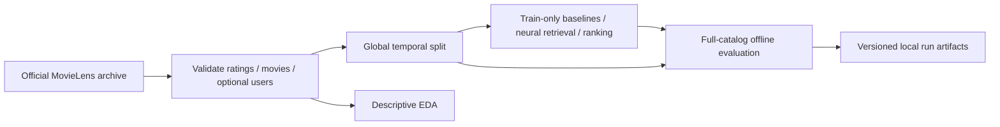
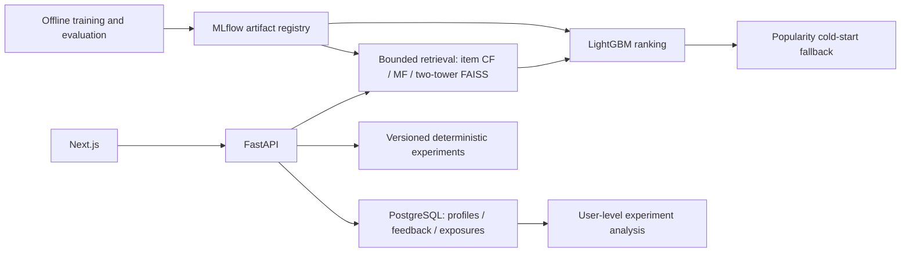

# Architecture and phased plan

Phases 1–6 are implemented: offline models, local FastAPI/PostgreSQL serving, a Next.js app and opt-in randomized experimentation. Phase 6 adds tracking, verified release selection/rollback, monitoring, drift checks, Compose and CI. Local Docker rollback checks and hosted clean Compose deployment passed; live experiment enrollment is off by default. Browser visual QA is outstanding; database/API tests and the production frontend build pass.

Future serving architecture:

1. **Foundations (complete):** ingestion for 1M and 32M formats, validation, descriptive EDA, global temporal splits, popularity, ranking metrics and user-bootstrap intervals. Gate: fixture tests and actual 1M run.
2. **Classical models (complete):** item CF and matrix factorization under the same frozen evaluation protocol. Gate: paired user-bootstrap differences, reproducibility and performance measurements.
3. **Retrieval and ranking (complete):** PyTorch two-tower, FAISS index, bounded retrieval and LightGBM ranking. Train ranker on time-separated out-of-fold candidates; measure candidate recall separately. Gate: leakage audit, retrieval/ranking ablations and artifact compatibility validation.
4. **Serving and app (implemented; visual QA pending):** FastAPI, PostgreSQL, real feedback logging, Next.js profiles/exploration/details/feedback and API-driven dashboards. Add Redis only if measured cache benefits justify invalidation complexity. Gate: integration tests and no training on request paths.
5. **Experimentation (implemented; no live outcome claim):** immutable experiment versions, deterministic user hashing, exposure/impression attribution, idempotent event ingestion, explicit synthetic namespace, SRM, user-level conversion, CIs/tests, power and guardrails. Gate: simulated null calibration; no online lift claims without real randomized observations.
6. **Operations:** MLflow tracking/registry, structured logs, latency/error metrics, drift checks, quality promotion gates, Docker Compose, CI, deployment documentation. Gate: reproducible clean deployment and rollback.

Repository: `src/recsyslab/{data,eda,models,evaluation,pipeline}.py`, `configs/`, `tests/`, `docs/`, `reports/`. Generated `data/` and `artifacts/` are ignored. Later phases can split modules into packages and add `backend/`, `frontend/`, `experimentation/`, and `infra/` when implemented.

Phase 2 implementation: `classical.py` contains sparse item CF, implicit ALS and artifact persistence; `benchmark.py` runs the common evaluation and paired comparisons. See [the Phase 2 contract](phase2.md).

Phase 3 implementation: `neural.py` trains the two towers and builds FAISS; `ranking.py` creates temporal query groups and persists the two-stage model; `stage3.py` runs the leakage audit and ablation benchmark. See [Phase 3 methodology](phase3.md).

Phase 4 implementation: `serving/` owns FastAPI, PostgreSQL schema v1, metadata import and live item-CF profile folding. `frontend/` contains the Next.js app. See [local startup, API semantics and verification limits](phase4.md).

Phase 5 implementation: `experimentation/` defines immutable designs, exact allocation checks, user-level inference, operator commands and file-only simulations. PostgreSQL schema v2 adds enrollment/exposure/attempt attribution. See [protocol and rollout gates](phase5.md).

## Phase 6 operating boundaries

Training produces a benchmark manifest and hashed model artifacts. The release tool copies and validates an immutable bundle; MLflow records its provenance and validation metrics. Explicit selection updates `current.json`, and the API verifies that selection once at startup. Its experiment/model compatibility check remains mandatory. Registry aliases cannot hot-swap serving weights.

JSON request logs and Prometheus record route-level service behavior, while the drift CLI analyzes rating/item distributions. Neither drift alerts nor offline metrics trigger automatic retraining, enrollment or promotion. The Compose stack orders database readiness, schema/catalog initialization, API readiness and the standalone frontend. See [the operating runbook](phase6.md) and [verification evidence](../reports/phase6/results.md) for boundaries and the outstanding clean-container gate.
