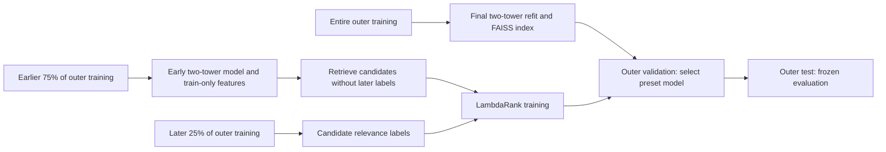

# Phase 3: neural retrieval and learning to rank

Phase 3 implements offline PyTorch two-tower training, a FAISS index, bounded candidate retrieval and a LightGBM LambdaRank model. It includes a retrieval-only ablation, classical baselines, candidate recall, paired uncertainty estimates and artifact checks. It does not add a service or frontend.

## Leakage boundaries

The original global 80/10/10 outer split and rating >= 4 positive definition remain unchanged. Within outer training, a second global cutoff at 75% creates one forward temporal fold:



The ranker never receives in-sample features from a retriever trained on its label window. The code checks both feature-history timestamps and the retriever's recorded maximum training timestamp against the earliest ranker label timestamp. Candidate IDs and features are built before looking up labels. Relevant items are never injected into a candidate list. Users with no positive retrieved label or no negative candidate are omitted from fitting because they supply no pairwise ordering signal; their counts are recorded. Fallback users are omitted because their recommendations bypass ranking.

After ranker training, a new retriever is fitted on the whole outer training partition. This is permitted training data for final evaluation, including the earlier ranker label window. Outer validation and test outcomes never enter training. Both validation and test use frozen final profiles/weights; test additionally filters validation-seen items, as in Phase 2.

This is **one forward temporal fold**, not multi-fold cross-validation. Refitting changes retrieval-score/popularity/genre-feature distributions between ranker training and evaluation. That is a real limitation, not a leakage fix by assumption. More rolling folds and calibration are future experiments. This protocol's small informative ranker cohort is explicitly reported.

## Two-tower model

The user tower is a user-ID embedding followed by Linear–ReLU–Linear layers. The item tower concatenates an item-ID embedding with a multi-hot genre vector, then uses separate Linear–ReLU–Linear layers. Each output is L2-normalized. Vocabulary and item eligibility derive only from the retriever training catalog; genre metadata is treated as static catalog information.

Training uses the pairwise loss `softplus(-(positive_score - negative_score) / temperature)`. Each positive training rating gets one uniformly sampled catalog negative per epoch, excluding **all positive ratings in that training partition**. Negatives may be unobserved or low-rated items; they are a learning assumption, not observed clicks or dislikes. Users positive on the entire catalog have no valid negative and are omitted from pair generation. A run without valid pairs fails. Defaults: 32 output dimensions, 5 epochs, batch size 2,048, Adam learning rate 0.002, temperature 0.2, weight decay 1e-5 and seed 42.

CPU execution is deterministic on the tested software/hardware with one PyTorch thread, fixed seeds and deterministic algorithms. A decrease in pairwise training loss does not establish better Top-K performance. Users with fewer than three positive training ratings or unknown user IDs use the same popularity fallback as Phase 2. This ID-based user tower does not encode new users from fresh histories.

## Retrieval and feature contract

FAISS `IndexFlatIP` performs exact inner-product search over normalized item vectors. This verifies correctness on MovieLens 1M; it is **not an approximate nearest-neighbor index** and still scans the catalog. For a budget M=200, retrieval requests at most `min(catalog_size, M + seen_catalog_count)` results, filters all seen movies, and returns at most M candidates. It may return fewer when the unseen catalog is exhausted. Ties within the returned FAISS set use movie ID; exact ties at the search boundary use FAISS's deterministic index order on the tested runtime.

Only this bounded candidate set reaches the ranker. It computes five ordered, finite numeric features:

| Feature | Source |
|---|---|
| `tower_score` | Inner product of frozen user/item vectors |
| `reciprocal_retrieval_rank` | 1 / rank in the candidate list |
| `log_item_positives` | log(1 + positive training rating count) |
| `log_user_positives` | log(1 + positive training profile size) |
| `genre_affinity` | Mean positive-history genre frequency across candidate genres |

No rating or timestamp from the label/evaluation window is a feature. Genre affinity uses only positive training profiles. Feature order is versioned and verified on load. The ranker uses LightGBM `lambdarank`, user query groups, binary labels, 60 boosting rounds, 15 leaves and a 0.05 learning rate. A label of zero means no positive rating in the label window, including missing observations; it is not an observed negative engagement event. Nonfinite inputs/scores fail validation. Ranking ties preserve retrieval order. Cold/limited-history users bypass the ranker.

## Evaluation and ablations

Popularity, item CF, two-tower retrieval-only and retrieval+ranking share the final training catalog, users, seen filters, K and relevance definitions. Classical models rank that catalog directly. The two-stage design intentionally ranks a bounded subset; this retrieval bottleneck is measured rather than concealed. Retrieval-only and ranked ablations use **identical 200-item candidate lists**.

Candidate Recall@200 is retrieved relevant items / all unseen held-out positives. Unreachable cold items stay in the denominator. Oracle Recall@10 is `min(10, retrieved relevant count) / held-out positive count`, an unattainable-label-assisted ceiling used only for diagnosis, never recommendation. Both include 95% user-bootstrap intervals and candidate recall is broken out by warm/fallback cohorts. Standard evaluation still reports Recall, Precision, NDCG, hit rate, coverage, diversity, novelty, popularity bias and sequential in-process timing.

Paired user-bootstrap differences compare ranked vs retrieval-only, ranked vs item CF, and retrieval-only vs popularity. They are exploratory offline differences, conditional on one split and preset; no multiple-comparison correction or causal online lift is claimed. A model is selected by validation NDCG before test evaluation. All test outcomes are reported without tuning to them. A more complex architecture is not presumed to outperform item CF.

## Persistence and auditability

The `two_stage/` directory contains `bundle.json`, a LightGBM text model and `retriever/`. The latter holds schema-versioned metadata, numeric NPZ network weights/vectors/ID maps/genres, sparse positive profiles, a FAISS index and SHA-256 checksums. No Python model object is loaded with pickle. Loading checks feature schema, bundle association, component hashes, dimensions, network-to-vector consistency and index-to-vector equality. These hashes detect accidental changes/mixing; they are not signatures authenticating an untrusted supplier. Use locally produced artifacts.

Before benchmarking, the complete bundle is reloaded and Top-K recommendations are checked for every fitted user and an unknown user. The run retains the fold retriever, query-group training matrix, candidate labels, fold time boundaries, epoch losses, ranker feature gains, per-user metrics and candidate metrics. The manifest records source/code/artifact fingerprints, configuration, library versions, fitting times and bundle size. User-level artifacts and raw data stay in ignored directories.

## Commands and dependencies

```bash
source .venv/bin/activate
python -m pip install -r requirements-phase3-lock.txt
python -m pip install -e '.[dev,phase3]'
MPLCONFIGDIR=/tmp/recsyslab-mpl \
OPENBLAS_NUM_THREADS=1 OMP_NUM_THREADS=1 VECLIB_MAXIMUM_THREADS=1 \
python -m recsyslab.stage3 --config configs/phase3.json --output artifacts/phase3-new
pytest -q
```

Use a fresh output directory. PyTorch 2.6.0, FAISS CPU 1.10.0 and LightGBM 4.6.0 are optional Phase 3 dependencies; Phases 1–2 retain their smaller lockfile. The Phase 3 modules initialize PyTorch before LightGBM, allowing the pinned macOS wheels to share the loaded OpenMP runtime. The fresh-process CLI test checks startup independently of test-module import order. In this restricted macOS execution environment, that subprocess test requires access to OpenMP shared memory; the full suite was run with that access. No duplicate-runtime suppression flag is used.

The tested platform is macOS ARM64, Python 3.9.6, CPU. Other platforms may require their standard OpenMP runtime. Full 32M training, accelerator execution, approximate-index recall and concurrent serving latency remain unvalidated. All user/item vectors are currently encoded at once; large catalogs may require batched encoding and a different index. No training occurs in `recommend()`.

Primary references: [PyTorch deterministic algorithms](https://docs.pytorch.org/docs/stable/generated/torch.use_deterministic_algorithms.html), [FAISS index types](https://github.com/facebookresearch/faiss/wiki/Faiss-indexes), [LightGBM ranking groups](https://lightgbm.readthedocs.io/en/stable/pythonapi/lightgbm.Dataset.html), [LightGBM parameters](https://lightgbm.readthedocs.io/en/stable/Parameters.html).
