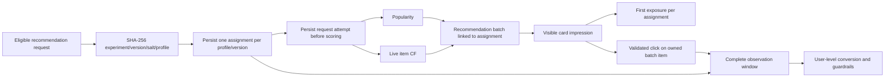

# Phase 5: randomized experimentation

Phase 5 implements immutable experiment definitions, deterministic profile-level assignment, persisted enrollment, visible exposure attribution, user-level outcome analysis, exact sample-ratio checks, guardrails, power planning and a separate synthetic diagnostic pipeline. The Next.js `/experiments` page reads these APIs. **No live experiment has been enabled or claimed to show engagement lift.**

## Implemented experiment

The supported comparison is **popularity control vs live-profile item-CF treatment**. Both policies can serve new app identities correctly. The Phase 3 neural user tower was trained on historical MovieLens IDs and is not a validated encoder for new live profiles; it is deliberately not used as a purported neural treatment. A future neural experiment needs a validated new-user representation and a new immutable definition.

Profiles become eligible after at least three positive live ratings on trained-catalog movies. Eligibility is checked before initial randomization. Assignment does not require a click, impression or successful recommendation. After assignment, the variant remains fixed during the profile's observation window even if ratings change and a fallback becomes necessary.

An experiment specification pins its name/version, salt, allocation, schedule, observation window, eligibility threshold, model artifact fingerprint, catalog size, assumed baseline, absolute minimum detectable effect, target power, significance levels and guardrail thresholds. Supported treatment probability ranges from 0.1 to 0.9. Registration is idempotent for the exact same definition and rejects changes under the same version. SHA-256 definition checks detect accidental edits, not a hostile database administrator rewriting both data and hashes.

The model version now fingerprints all four item-CF artifact components, including counts, ID maps and metadata, not only the similarity matrix. Startup refuses an active experiment if its pinned model or catalog differs. Model code, metadata and eligibility semantics must remain operationally frozen during a run; do not redeploy changed scoring behavior under an existing experiment version.

## Enrollment and attribution



The hash maps the first 64 digest bits into a uniform bucket. The experiment key and salt define the randomization namespace. The result is persisted under a unique `(experiment_key, profile_id)` constraint; profile locks serialize concurrent enrollment requests. The browser's existing session cookie retains the profile across sessions. This is **browser-profile randomization, not verified person-level identity**: clearing cookies or using another browser creates a different unit, a limitation inherited from Phase 4's local identity mechanism.

Enrollment is committed before scoring. Failed scoring requests retain their assignment and request attempt, and their error response is recorded. A middleware timer measures server processing from request entry through response readiness, excluding network delivery and the telemetry-write overhead. Failed/missing telemetry remains null and blocks review; it is not silently counted as success. Requests rejected before experiment instrumentation (authentication, validation or initial database failure) are outside this cohort guardrail. Full service-outage monitoring remains Phase 6 work.

Generating a batch is not exposure. A visible impression creates the first exposure for that assignment. Further card impressions remain separately logged and deduplicated. Clicks must reference an owned, linked batch item with an existing impression. A click contributes to the primary outcome only if its server timestamp is within `[assigned_at, window_ends_at)`. Clicks on nonexperiment batches or after the window never count. The first-exposure timestamp is a diagnostic; it does not select the primary denominator.

No enrollment occurs outside the definition's `[starts_at, ends_at)` schedule. Existing assignments continue their variant through their individual follow-up, even after enrollment closes. A profile is not re-enrolled in the same version after its window ends. Overlapping versions cannot enroll the same profile during an existing observation window. Use only one active experiment at a time; changing ACTIVE_EXPERIMENT or disabling it mid-follow-up changes delivered treatment and invalidates the intended fixed-horizon interpretation. Disabling is available as an operational stop, not a way to preserve a clean causal result.

## Primary metric and inference

The primary metric is **any attributed recommendation click within 24 hours of enrollment**, one binary outcome per profile. The window is configurable from 1 to 168 hours. Only mature profiles with fully elapsed windows enter the primary comparison. All mature enrolled profiles remain in the denominator, including users with no visible impression, no click or a failed request: an intention-to-treat analysis. Pending users and first exposures are reported separately. SRM uses **all enrollments**, including pending windows, to avoid an outcome-dependent population.

Each arm's conversion interval uses Wilson's binomial interval. The absolute treatment-minus-control interval uses the Newcombe independent-proportion construction. The primary hypothesis test is two-sided Fisher exact, which remains defined at sparse/zero counts. An absent arm returns null estimates/tests, not a fabricated zero rate. Relative lift is null when control conversion is zero. Primary confidence is `1 - alpha` from the definition; default 95%.

Allocation SRM uses the exact two-sided binomial test against the registered treatment probability, with default threshold 0.001. A mismatch blocks review; it is not evidence of treatment effect. See [SciPy Fisher exact documentation](https://docs.scipy.org/doc/scipy/reference/generated/scipy.stats.fisher_exact.html) and [Microsoft's SRM guidance](https://www.microsoft.com/en-us/research/articles/diagnosing-sample-ratio-mismatch-in-a-b-testing/).

## Planning and guardrails

The plan uses a normal-approximation two-proportion sample-size calculation, supporting unequal allocation. Its assumptions are independent profiles, a fixed baseline and absolute effect, two-sided alpha, and no attrition adjustment. It is not post-hoc observed power. The example uses **assumed** 10% conversion, a 2-percentage-point improvement, 80% power and 5% alpha, yielding **3,841 mature profiles per arm (7,682 total)**. Those assumptions are not derived from MovieLens ratings or fabricated historical clicks; replace them prospectively with justified values before registration.

| Guardrail | Unit / uncertainty | Default threshold |
|---|---|---|
| API processing latency | Mean request latency within each profile, then an equal-profile mean; independent profile bootstrap 95% CI for difference | Upper difference bound <= 20 ms |
| Any request error | Binary indicator that a profile had at least one failed instrumented recommendation request; Newcombe 95% difference interval | Upper difference bound <= 0.01 |
| Catalog coverage | Union of recommended items / pinned catalog size over mature profiles' in-window attempts; descriptive difference, no hypothesis test | Difference >= -0.05 |

Error probability is not the per-request error rate; repeated requests do not become independent experimental units. The report also exposes descriptive mean within-profile request error rates. Coverage is inherently affected by traffic volume and repeat usage, so its threshold is an operational heuristic, not a statistically established effect. No multiplicity correction is claimed for the guardrail intervals; they are conservative operational review gates, not extra primary hypotheses.

`review_eligible` is true only after the enrollment end plus the full follow-up duration, both arms reach their planned mature sample counts, SRM is clear, request telemetry is complete, and all guardrails clear. Synthetic reports always fail the live-review gate. **There is no automatic winner or automatic deployment**, even when review is eligible. Interim p-values are displayed as descriptive only. Do not repeatedly peek and stop on significance; no sequential-inference procedure is implemented. A fixed-horizon result still requires operator review of exposure delivery, identity limitations and data quality.

## Schema migration and operator workflow

Schema v2 adds `experiments`, `experiment_assignments`, `experiment_batches`, `experiment_exposures` and `experiment_attempts`. Existing Phase 4 tables and records are retained. The explicit migration is transactional, idempotent and advisory-lock protected; unknown versions fail before mutation. Server startup requires v2 and never runs a migration itself.

```bash
source .venv/bin/activate
# DATABASE_URL must point at your chosen PostgreSQL database.
python -m recsyslab.serving.migrations
# Inspect the required sample size without connecting to a database:
python -m recsyslab.experimentation.cli plan \
  --config configs/experiment_popularity_vs_cf.v1.json
```

The example configuration contains explicit UTC enrollment timestamps and a fingerprint for the retained Phase 2 artifact. Set a prospective schedule and justify assumptions **before** registering. Once registered, change the version for any changes.

```bash
python -m recsyslab.experimentation.cli register \
  --config configs/experiment_popularity_vs_cf.v1.json
# Registration alone does not enroll anyone. Deliberate activation:
export ACTIVE_EXPERIMENT='popularity-vs-item-cf:v1'
# Set EXPERIMENT_ADMIN_TOKEN to a long random secret in your environment.
# Do not commit it, place it in a URL, or expose it via NEXT_PUBLIC variables.
python scripts/run_phase4.py
```

Leave ACTIVE_EXPERIMENT unset for ordinary Phase 4 behavior. The local public database has been migrated to v2 but has **no registered experiment, assignment or generated engagement event**. Tests and HTTP QA used separate schemas. No live experiment is automatically activated by installation, migration, registration or simulation.

The `/experiments` dashboard has distinct Live and Synthetic tabs. Live aggregate analysis requires an operator token configured by EXPERIMENT_ADMIN_TOKEN. With no token configured, live reporting returns 503; an incorrect/missing token returns 403. The dashboard holds an entered token only in page memory, never browser storage or URLs. No experiment-management HTTP mutation endpoint is exposed. Registration and export are operator CLI actions.

```bash
python -m recsyslab.experimentation.cli analyze \
  --key 'popularity-vs-item-cf:v1' --output artifacts/live-analysis.json
```

The export refuses to overwrite an existing file. It contains aggregate counts, not raw profile IDs. There is no API parameter to move the analysis clock into the future; live analysis uses server time.

## API additions

| Endpoint | Behavior |
|---|---|
| `GET /api/experiments` | Registered immutable definitions and active key; no outcomes |
| `GET /api/experiments/assignment` | Current profile's persisted assignment; does not enroll |
| `GET /api/experiments/{key}/analysis` | Operator-only live aggregate report, `X-Experiment-Admin` header |
| `GET /api/experiments/synthetic` | Separately labeled file-only simulation report |
| `POST /api/recommendations` | Existing route now enrolls eligible users when explicitly active and returns assignment metadata |
| `POST /api/impressions` | Existing route also records first visible experiment exposure |

Primary outcomes are not card click-through from the Activity page; that page remains a descriptive profile dashboard. Offline model benchmarks, live randomization and generated simulations remain separate sources.

## Synthetic diagnostics and tests

```bash
python -m recsyslab.experimentation.simulate --output artifacts/synthetic-experiments.json
# The dashboard reads reports/phase5/simulation.json; write a new artifact first
# and deliberately replace the report only when you intend to update it.
```

The simulator does not open a database connection. It generates labeled null, injected-effect and deliberately corrupted-assignment scenarios, plus 500 independent equal-rate null experiments. All scenario rates, latencies, item IDs and outcomes are generated, never represented as MovieLens observations. The injected-effect scenario is a diagnostic with a known artificial probability change, not a claimed business improvement. The repeated simulation is exactly reproducible with its fixed seeds.

The null calibration observed 19 rejections out of 500 (3.8%), with Monte Carlo Wilson 95% interval [2.45%, 5.86%], encompassing the nominal 5%. This checks the fixed-sample test under this particular Bernoulli model; it does not establish real-world calibration, sufficient power, person-level independence or sequential-testing safety.

The full suite has 45 passing tests, including PostgreSQL migration preservation, concurrent deterministic assignment, immutable versions, model pinning, eligibility, actual control/treatment branches, failed-scoring denominators, exposure deduplication, maturity, closed-window behavior, click attribution, SRM blocking and missing telemetry. HTTP QA exercises the built Next.js proxy with an isolated active QA definition. These are synthetic test actions, not live engagement results.

Browser visual QA remains unavailable because Computer Use permission was not granted in this environment. The production build, TypeScript checks and HTTP flow pass; they do not prove rendered layout or browser interaction behavior. See [verification results](../reports/phase5/results.md).

Phase 6 deployment, MLflow promotion, drift monitoring, production authentication and broader operational controls remain outstanding. Memory-based analysis currently loads an experiment's rows in one process and bootstraps there; large-scale experiments will need SQL aggregation, bounded jobs, indexes/profiling and asynchronous report execution.
