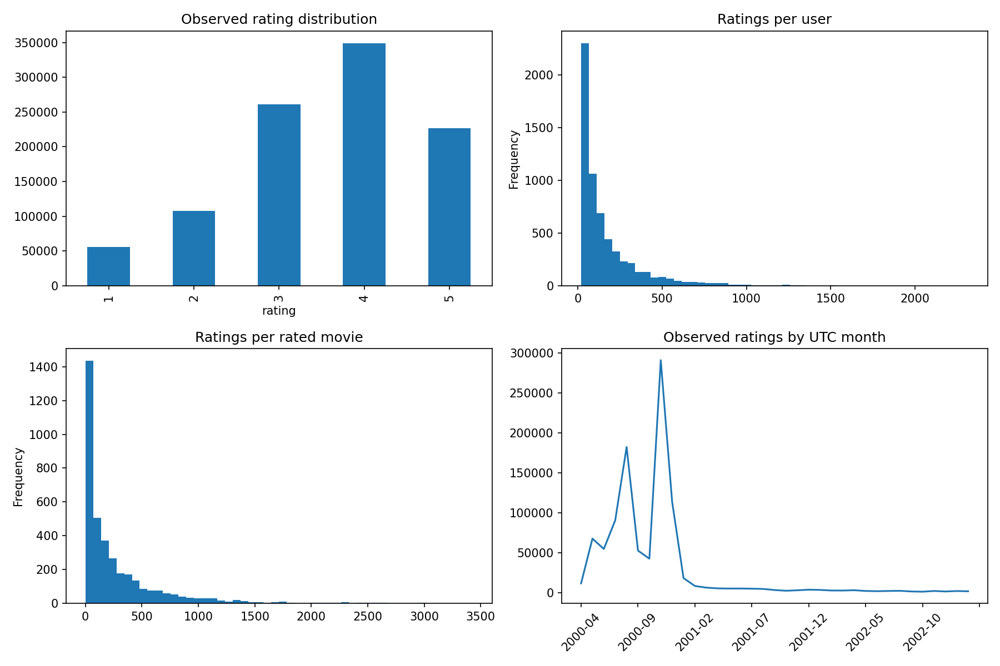

# Phase 1 verified results

Executed on official MovieLens 1M with Python 3.9.6; all 12 tests passed. Matplotlib emits 14 upstream Pyparsing deprecation warnings; no test failures.

## Commands executed

```bash
MPLCONFIGDIR=/tmp/recsyslab-mpl PYTHONPYCACHEPREFIX=/tmp/recsyslab-pycache .venv/bin/python -m pytest -q
MPLCONFIGDIR=/tmp/recsyslab-mpl .venv/bin/python -m recsyslab.pipeline download --dataset 1m
MPLCONFIGDIR=/tmp/recsyslab-mpl PYTHONPYCACHEPREFIX=/tmp/recsyslab-pycache .venv/bin/python -m recsyslab.pipeline run --output artifacts/phase1-final
```

Validated 1,000,209 ratings, 6,040 users and 3,883 metadata movies (3,706 rated). Mean rating: 3.5816; matrix sparsity: 95.74%.

Rows: training 800,164, validation 100,024, test 100,021. Exact cutoff timestamps and source hashes are in [manifest.json](manifest.json).

| Metric @10 | Validation mean | Test mean | Test 95% user-bootstrap CI |
|---|---:|---:|---|
| recall | 0.060735 | 0.056530 | [0.051743, 0.061989] |
| precision | 0.240979 | 0.200084 | [0.187117, 0.213388] |
| ndcg | 0.260403 | 0.217503 | [0.203787, 0.231916] |
| hit_rate | 0.662738 | 0.638889 | [0.611953, 0.664141] |
| diversity | 0.781232 | 0.783499 | [0.780621, 0.786283] |
| popularity_bias | 1818.724751 | 1673.700253 | [1658.593678, 1689.001328] |
| novelty_bits | 8.028918 | 8.158308 | [8.142088, 8.173984] |

Diversity, popularity bias and novelty describe the Top-10 list; only the first four rows are relevance metrics.

Test: 1,188 positive users evaluated; 21 users without positives excluded. 29 evaluated users have no pre-test history. Catalog coverage: 3.96%. Unreachable positive fraction: 0.0918%.

The rating distribution favors higher ratings. User and item activity have long tails; rating volume is concentrated early in the collection period. These descriptive patterns motivate reporting temporal and cold-start cohorts in future model comparisons, and do not establish causal preferences.



Full aggregates, intervals and local timing are in [metrics.json](metrics.json). These timings are sequential in-process microbenchmarks, not serving performance. User-level data and model artifacts remain locally under ignored `artifacts/`.

No advanced model comparison, real online experiment, service, frontend or deployment is implemented. Full 32M execution remains unvalidated. Next step is Phase 2 classical models under the documented common evaluation contract.

The final optimized pipeline was rerun on the complete 1M dataset. EDA summaries, model artifact bytes, ranking metrics, confidence intervals and cohort counts exactly matched the initial run; only hardware timing measurements vary.
