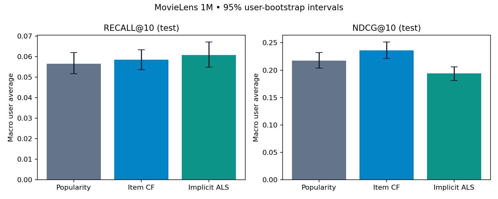

# Phase 2: verified MovieLens 1M benchmark

All models were fitted on the same 800,164 training ratings. Validation contains 100,024 ratings; test contains 100,021. Positive ratings are >= 4; K=10. All comparisons use the full training catalog and frozen training profiles.

**Validation selected item CF by macro NDCG@10.** No test-driven tuning was performed. ALS improves recall and catalog coverage over popularity in this configuration, but its NDCG and precision are lower. This is an offline comparison, not an online A/B test.

## Test results

| Model | Recall@10 | Precision@10 | NDCG@10 | Hit rate@10 | Catalog coverage |
|---|---:|---:|---:|---:|---:|
| popularity | 0.05653 | 0.20008 | 0.21750 | 0.63889 | 3.96% |
| item_cf | 0.05850 | 0.21456 | 0.23634 | 0.63805 | 6.12% |
| implicit_als | 0.06080 | 0.18013 | 0.19380 | 0.62626 | 30.39% |



## Paired test differences

Differences are treatment minus control. The same users are resampled together 1,000 times. These exploratory intervals are conditional on this split/model and are not corrected for multiple comparisons.

| Comparison | Metric | Mean difference | 95% paired CI |
|---|---|---:|---|
| item_cf_vs_popularity | recall@10 | +0.00197 | [-0.00269, +0.00588] |
| item_cf_vs_popularity | ndcg@10 | +0.01883 | [+0.01184, +0.02555] |
| implicit_als_vs_popularity | recall@10 | +0.00427 | [-0.00249, +0.01124] |
| implicit_als_vs_popularity | ndcg@10 | -0.02370 | [-0.03504, -0.01296] |
| implicit_als_vs_item_cf | recall@10 | +0.00230 | [-0.00410, +0.00924] |
| implicit_als_vs_item_cf | ndcg@10 | -0.04253 | [-0.05390, -0.03286] |

## Cohorts and selection

| Model | Validation NDCG@10 | Test warm NDCG@10 | Test fallback NDCG@10 |
|---|---:|---:|---:|
| popularity | 0.26040 | 0.20687 | 0.26819 |
| item_cf | 0.26877 | 0.22965 | 0.26819 |
| implicit_als | 0.25348 | 0.17820 | 0.26819 |

Validation evaluates 1,103 positive users (489 warm, 614 fallback-eligible). Test evaluates 1,188 positive users (982 warm, 206 fallback-eligible). Fallback means fewer than three positive **training** ratings. All models produce the same fallback-cohort recommendations. Users without positive target ratings are excluded from recall: 31 in validation and 21 in test. Their counts are exposed in the metrics.

## Local performance

| Model | Fit seconds | Artifact MiB | Test p50 ms | Test p95 ms | Sequential calls/sec |
|---|---:|---:|---:|---:|---:|
| popularity | 0.006 | 0.086 | 0.0015 | 0.0054 | 480649 |
| item_cf | 0.635 | 3.375 | 0.7468 | 0.8029 | 1600 |
| implicit_als | 1.754 | 2.840 | 0.7680 | 0.8175 | 1559 |

These are machine-dependent, sequential in-process timings with BLAS thread limits set to one. They are not API latency, concurrent throughput or deployment guarantees. Artifact size includes the sparse training-positive profiles required by these implementations.

## Reproduction and validation

```bash
MPLCONFIGDIR=/tmp/recsyslab-mpl PYTHONPYCACHEPREFIX=/tmp/recsyslab-pycache \
OPENBLAS_NUM_THREADS=1 OMP_NUM_THREADS=1 VECLIB_MAXIMUM_THREADS=1 \
.venv/bin/python -m recsyslab.benchmark --output artifacts/phase2-1m

MPLCONFIGDIR=/tmp/recsyslab-mpl PYTHONPYCACHEPREFIX=/tmp/recsyslab-pycache \
OPENBLAS_NUM_THREADS=1 VECLIB_MAXIMUM_THREADS=1 .venv/bin/python -m pytest -q
```

Two independent complete 1M runs produced exactly identical user scores, all non-timing metrics, paired intervals and validation selection. Popularity metrics also exactly match Phase 1. The second run used `--output artifacts/phase2-repeat`.

18 tests passed. The 14 warnings are upstream Matplotlib/Pyparsing deprecations. Tests cover exact ALS equations, cosine similarity, self-edge removal, neighborhood bounds, seen-item filtering, deterministic refits, persistence, fallback, paired-user alignment and held-out isolation. Both personalized artifacts are reloaded and all training users’ raw scores checked before each benchmark evaluation.

Full metric intervals, diversity, novelty, popularity bias and timing are in [metrics.json](metrics.json); all paired comparisons are in [paired_comparisons.json](paired_comparisons.json). Provenance, configuration, dependency versions and code/artifact hashes are in [manifest.json](manifest.json). User-level outputs remain local under ignored `artifacts/`.

## Limits and remaining work

Only one preset per model family was tested; these results do not establish that one model family is universally better. Ratings are observational and missing feedback is not an observed dislike. The ALS confidence objective is a modeling assumption. Profiles remain frozen even when validation history is available at test time. The differing warm/fallback proportions make aggregate validation and test results incomparable without cohort context.

MovieLens 32M execution remains unvalidated. Sparse item similarities and Python ALS need scaling benchmarks before larger claims. Phase 3 will add two-tower retrieval, FAISS and ranking with leakage-safe ranker training; serving, frontend, online experimentation and deployment remain later phases.
