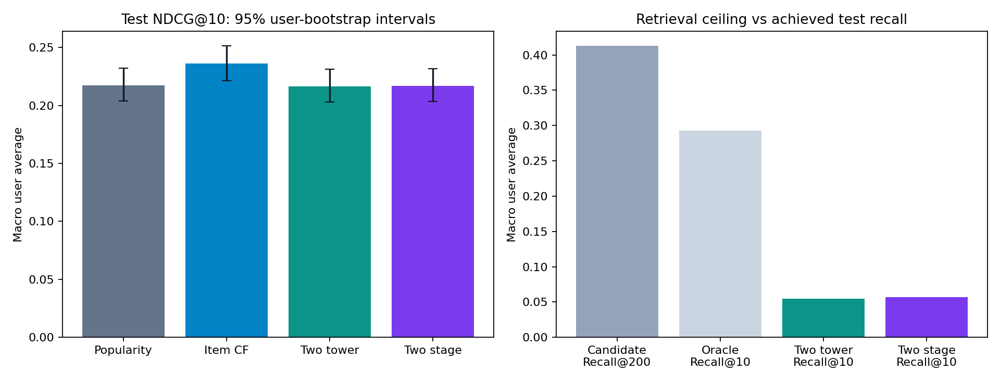

# Phase 3: verified neural retrieval and ranking

**Phase 3 is functional; item CF remains the validation-selected model.** The two-stage architecture does not establish an improvement over that simpler baseline. Test NDCG changes only slightly after ranking, and the paired interval includes zero. No online engagement or A/B-testing claim is made.

Official MovieLens 1M was split into 800,164 training, 100,024 validation and 100,021 test ratings, using the same global timestamps and relevance threshold as Phases 1–2. All four models use the same final training catalog and seen-item filters. No outer validation/test outcome is used in fitting.

## Test comparison

| Model | Recall@10 | Precision@10 | NDCG@10 | Hit rate@10 | Coverage |
|---|---:|---:|---:|---:|---:|
| popularity | 0.05653 | 0.20008 | 0.21750 | 0.63889 | 3.96% |
| item_cf | 0.05850 | 0.21456 | 0.23634 | 0.63805 | 6.12% |
| two_tower | 0.05449 | 0.20152 | 0.21630 | 0.63889 | 6.28% |
| two_stage | 0.05698 | 0.19756 | 0.21691 | 0.63300 | 8.06% |



Both neural ablations retrieve the same bounded set of 200 unseen items. Only `two_stage` reranks it. Cold/limited-history users bypass ranking and use popularity.

## Retrieval diagnostics

| Split | Candidate Recall@200 (95% CI) | Oracle Recall@10 (95% CI) | Warm candidate recall | Fallback candidate recall |
|---|---|---|---:|---:|
| validation | 0.45109 [0.43620, 0.46548] | 0.30442 [0.28883, 0.31929] | 0.43009 | 0.46782 |
| test | 0.41319 [0.40184, 0.42568] | 0.29301 [0.28041, 0.30633] | 0.40839 | 0.43608 |

Each evaluated user received exactly 200 candidates in this run. Candidate recall keeps cold-item positives in its denominator. Oracle Recall@10 assumes perfect labels to order the candidates; it is a diagnostic ceiling, not a deployed prediction. FAISS uses exact IndexFlatIP, not approximate nearest-neighbor search.

## Paired test differences

Exploratory user-bootstrap intervals (1,000 resamples) for treatment minus control, without multiple-comparison correction:

| Comparison | Metric | Mean difference | 95% paired CI |
|---|---|---:|---|
| two_stage_vs_two_tower | recall@10 | +0.00249 | [-0.00111, +0.00695] |
| two_stage_vs_two_tower | ndcg@10 | +0.00061 | [-0.00535, +0.00659] |
| two_stage_vs_item_cf | recall@10 | -0.00152 | [-0.00545, +0.00330] |
| two_stage_vs_item_cf | ndcg@10 | -0.01942 | [-0.02625, -0.01195] |
| two_tower_vs_popularity | recall@10 | -0.00204 | [-0.00640, +0.00151] |
| two_tower_vs_popularity | ndcg@10 | -0.00120 | [-0.00768, +0.00497] |

## Validation selection and cohorts

| Model | Validation NDCG@10 | Test warm NDCG@10 | Test fallback NDCG@10 |
|---|---:|---:|---:|
| popularity | 0.26040 | 0.20687 | 0.26819 |
| item_cf | 0.26877 | 0.22965 | 0.26819 |
| two_tower | 0.26365 | 0.20542 | 0.26819 |
| two_stage | 0.26526 | 0.20616 | 0.26819 |

Validation contains 489 warm and 614 fallback-eligible positive users; test contains 982 warm and 206 fallback-eligible positive users. Fallback means fewer than three positive final-training ratings. The differing cohort proportions materially affect aggregate comparisons across windows. The final selection was recorded before test evaluation; the preset was not tuned to test outcomes.

## Ranker training audit

The forward fold uses 600,120 earlier ratings for retriever features and 200,044 later outer-training ratings for labels. Maximum feature-history timestamp: `974687962`; earliest label timestamp: `974687964`. Timestamp ties remain entirely on the later side.

The ranker learned from **189 informative user groups**, 37,800 candidate rows and 2,654 positive candidate labels. It skipped 1,320 fallback users, 74 users without a retrieved positive, and 0 users without a negative candidate. No positive candidate was injected. This small, selected cohort limits generalization.

The final retriever was refitted on all outer-training ratings after candidate/label generation. Ranker training features remain from the earlier retriever. Refitting changes score and feature distributions; this distribution shift is documented rather than assumed away. One forward fold is not multi-fold cross-validation.

Fold pairwise training loss: 0.455154 → 0.271204. Final retriever loss: 0.418724 → 0.266283. Loss reduction is not proof of improved recommendation quality.

## Performance and artifacts

| Model | Test p50 ms | Test p95 ms | Sequential calls/sec |
|---|---:|---:|---:|
| popularity | 0.0015 | 0.0041 | 553234 |
| item_cf | 0.7900 | 0.8561 | 1508 |
| two_tower | 0.1455 | 0.3444 | 6368 |
| two_stage | 0.3682 | 0.5684 | 2935 |

Training wall times:

- fold_retriever: 2.181 seconds.
- ranker: 0.140 seconds.
- final_retriever: 2.508 seconds.
- popularity: 0.008 seconds.
- item_cf: 0.629 seconds.

Complete two-stage bundle: 3.411 MiB. Timings are sequential in-process CPU measurements, not API or concurrent-load guarantees. Every fitted user's recommendations were checked against the reloaded bundle before evaluation.

## Reproduction and checks

```bash
python -m pip install -r requirements-phase3-lock.txt
python -m pip install -e '.[dev,phase3]'
MPLCONFIGDIR=/tmp/recsyslab-mpl PYTHONPYCACHEPREFIX=/tmp/recsyslab-pycache \
OPENBLAS_NUM_THREADS=1 OMP_NUM_THREADS=1 VECLIB_MAXIMUM_THREADS=1 \
.venv/bin/python -m recsyslab.stage3 --output artifacts/phase3-new

MPLCONFIGDIR=/tmp/recsyslab-mpl PYTHONPYCACHEPREFIX=/tmp/recsyslab-pycache \
OPENBLAS_NUM_THREADS=1 OMP_NUM_THREADS=1 VECLIB_MAXIMUM_THREADS=1 \
.venv/bin/python -m pytest -q
```

**26 tests passed**, with 14 upstream Matplotlib/Pyparsing deprecation warnings. The fresh-subprocess test required macOS OpenMP shared-memory access outside the sandbox. CLI startup, brute-force/FAISS agreement, negative sampling, seen filtering, candidate bounds, temporal leakage guards, no positive injection, deterministic training, artifact integrity, and outer-held-out isolation are tested.

The initial full run and the final independently refitted run produced identical weights/vectors, ranker text, ranker matrices, loss sequences, all non-timing metrics, candidate diagnostics and paired intervals. The final run adds the retriever training-time provenance guard. Popularity and item-CF metrics exactly match Phase 2. The retained final run is `artifacts/phase3-final`; its hashes and versions are in [manifest.json](manifest.json).

Aggregate files: [metrics](metrics.json), [paired comparisons](paired_comparisons.json), [candidate diagnostics](candidate_metrics.json), [fold audit](ranker_fold.json), [training losses and feature gains](training.json). User-level data and fitted artifacts remain in ignored local directories.

## Remaining limits

No observed clicks/conversions are invented. Sampled negatives and missing candidate labels are modeling assumptions, not observed dislikes. Only one configuration and one forward fold were tested. Full 32M training, GPU execution, approximate FAISS indexing, API serving and online randomized experiments remain unvalidated or unimplemented. Phase 4 is serving and the user application; this turn stops at Phase 3.
